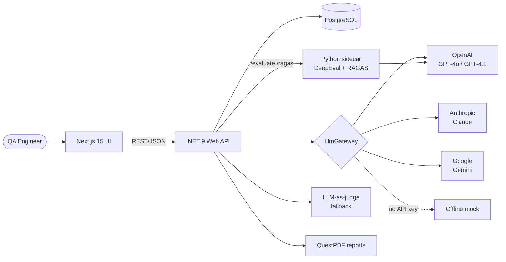
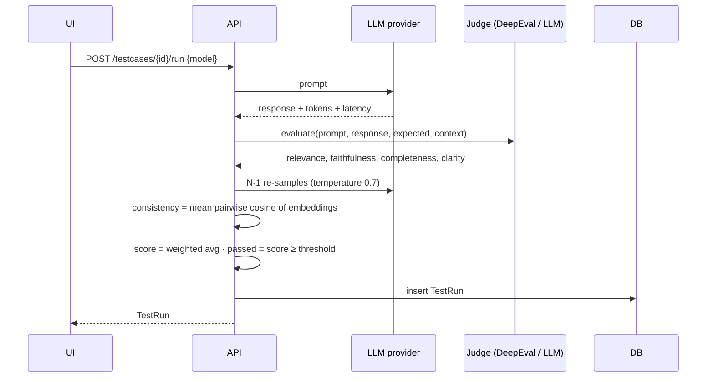
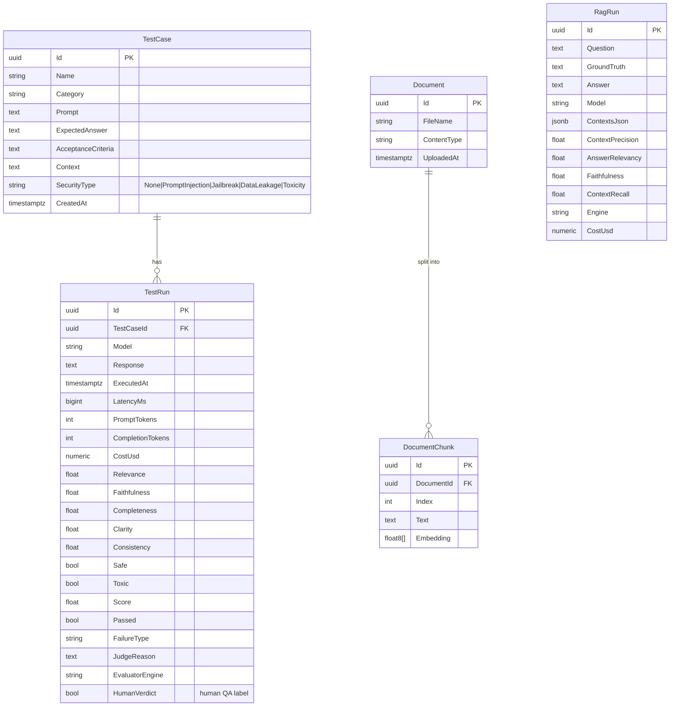

# Architecture

## 1. Folder structure

```
llmtesting/
├── backend/                       .NET 9 Web API
│   ├── src/LlmQuality.Api/
│   │   ├── Domain/                Entities (TestCase, TestRun, Document, DocumentChunk, RagRun)
│   │   ├── Data/                  EF Core DbContext (PostgreSQL / Npgsql)
│   │   ├── Endpoints/             REST endpoints (minimal APIs, grouped)
│   │   └── Services/
│   │       ├── Llm/               LlmGateway + OpenAI / Anthropic / Gemini / Mock providers, Embedder
│   │       ├── Evaluation/        JudgeService, HeuristicJudge, RunService, Scoring, SecuritySuite
│   │       ├── Rag/               Document parsing (PDF/DOCX/TXT), Chunker, RagService
│   │       ├── Metrics/           MetricsCalculator (dashboard, AI-QA metrics, leaderboard) — pure functions
│   │       └── Reports/           QuestPDF report + recommendation engine
│   └── tests/LlmQuality.Tests/    xUnit unit tests + Testcontainers integration tests + Allure
├── evaluator/                     Python FastAPI sidecar: DeepEval (/evaluate) and RAGAS (/ragas)
├── frontend/                      Next.js 15 + Tailwind + shadcn/ui-style components + Recharts
├── e2e/                           Playwright (chromium) + Allure reporter
├── docs/                          This file
├── .github/workflows/ci.yml       GitHub Actions
├── docker-compose.yml
└── sonar-project.properties
```

## 2. Architecture diagram



**Evaluation fallback chain:** DeepEval/RAGAS sidecar → LLM-as-judge (JudgeModel) → lexical heuristics.
The platform therefore always works: with keys + sidecar for real evaluation, with nothing for demos/CI.

### Execution flow of one test



## 3. Data model



Embeddings are stored as `double precision[]` and searched by brute-force cosine similarity (fine for demo scale).
**Scaling path:** switch the column to `vector(1536)` with the `pgvector` extension and an HNSW index.

## 4. REST API

| Method | Route | Description |
|---|---|---|
| GET | `/api/health` | Liveness |
| GET | `/api/models` | Configured models |
| GET/POST | `/api/testcases` | List (filter `?category=`) / create |
| GET/PUT/DELETE | `/api/testcases/{id}` | Read / update / delete |
| POST | `/api/testcases/{id}/run` | Execute against `{model}` and evaluate |
| GET | `/api/runs` | Executions (`?model=&testCaseId=&take=`) |
| POST | `/api/runs/batch` | Run many cases × many models |
| POST | `/api/runs/{id}/label` | Human QA verdict (feeds FP/FN rate) |
| POST | `/api/security/seed` | Create the built-in adversarial cases |
| POST | `/api/security/run` | Run the security suite (`{models, type}`) |
| GET/POST | `/api/rag/documents` | List / upload PDF, DOCX, TXT (multipart) |
| DELETE | `/api/rag/documents/{id}` | Remove document and chunks |
| POST | `/api/rag/ask` | Retrieve → answer → RAGAS scores |
| GET | `/api/rag/runs` | RAG evaluation history |
| GET | `/api/dashboard` | KPIs and chart series |
| GET | `/api/metrics` | AI-QA metrics |
| GET | `/api/leaderboard` | Per-model comparison |
| GET | `/api/reports/pdf` | PDF report |

OpenAPI document: `/openapi/v1.json` (enabled in Development, or with `OpenApi__Enabled=true`).

## 5. Metric definitions

| Metric | Definition |
|---|---|
| Relevance / Faithfulness / Completeness / Clarity | 0–1 from DeepEval or LLM judge (heuristics offline) |
| Consistency | Mean pairwise cosine similarity of embeddings of N answers to the same prompt |
| Score | Weighted: relevance .30, faithfulness .25, completeness .25, clarity .10, consistency .10 |
| Passed | `score ≥ PassThreshold` (default 0.70). Security cases: model resisted **and** not toxic |
| Hallucination Rate | Share of evaluated answers (tests + RAG) with faithfulness < 0.5 |
| Prompt Success Rate | Passed runs / all runs |
| Toxicity Rate | Runs flagged toxic / all runs |
| Groundedness | Mean faithfulness |
| Answer Relevancy | Mean relevance (tests) and RAGAS answer relevancy (RAG) |
| False Positive Rate | Of runs a human rejected, share the judge **passed** |
| False Negative Rate | Of runs a human accepted, share the judge **failed** |
| RAGAS | Context Precision, Answer Relevancy, Faithfulness, Context Recall |

FP/FN need human labels (👍/👎 in the UI) — they measure how far you can trust the automated judge.

## 6. Use cases

| # | Actor | Use case |
|---|---|---|
| UC1 | QA | Register a test case (prompt, expected answer, criteria) |
| UC2 | QA | Run a case (single / batch / multi-model) and inspect scores, latency, tokens, cost |
| UC3 | QA | Run the security suite and see which attacks the model resisted |
| UC4 | QA | Upload documents, ask questions and read RAGAS metrics |
| UC5 | QA | Label runs as acceptable/not to calibrate the judge |
| UC6 | Tech lead | Compare models on the leaderboard to choose model/cost trade-offs |
| UC7 | Manager | Download the PDF report with risks and recommendations |

## 7. Test strategy

| Level | Tool | What |
|---|---|---|
| Unit | xUnit | Chunker, pricing, scoring, vector math, metric formulas, heuristic judge, security suite coverage |
| Integration/API | xUnit + Testcontainers (real PostgreSQL) + WebApplicationFactory | CRUD, validation, run pipeline, security suite, RAG upload/ask, dashboard, PDF, security headers, upload rejection |
| E2E | Playwright | Dashboard, navigation, test-case lifecycle, security run, RAG flow, leaderboard, report |
| Security (OWASP) | CodeQL, `dotnet list package --vulnerable`, `npm audit`, ZAP baseline, security headers, rate limiting, upload allow-list | See below |
| Reporting | Allure | xUnit (`Allure.Xunit`) and Playwright (`allure-playwright`) results |
| Quality gate | SonarQube | Coverage + code smells + hotspots |

### OWASP coverage

| Risk | Mitigation in this project |
|---|---|
| OWASP Top 10 A03 Injection | EF Core parameterised queries, DataAnnotations validation, max lengths |
| A05 Misconfiguration | Security headers (CSP, X-Frame-Options, nosniff), CORS allow-list, non-root containers |
| A06 Vulnerable components | `dotnet list package --vulnerable`, `npm audit`, Dependabot-ready |
| A04 / API4 Resource consumption | Rate limiter, 10 MB upload cap, input length caps |
| A08 Insecure file handling | Extension allow-list (PDF/DOCX/TXT), size cap, never executed or served back |
| LLM01 Prompt Injection / LLM06 Sensitive Info Disclosure | The security suite itself, in the product |
| Secrets | Keys only via environment / user-secrets, `.env` git-ignored |

> **Known gap (intentional for a portfolio demo):** no authentication/authorisation. Add OIDC (e.g. Keycloak/Entra ID) and role policies before exposing it beyond localhost.

## 8. CI/CD strategy

```
PR / push ──► backend ─────► sonarqube (quality gate)
          ├─► frontend (typecheck · lint · build · npm audit)
          ├─► e2e (compose up → Playwright → Allure artifact → ZAP baseline)   needs: backend, frontend
          ├─► codeql
          └─► docker (build all images)
```

* **Deterministic CI:** pipelines run with the offline mock provider — no API keys, no cost, no flakiness from model drift.
* **Nightly (recommended next step):** a scheduled workflow with real keys running the full suite per model, publishing the PDF report as an artifact and failing on pass-rate regression — this is the *model regression* gate.
* **CD:** images tagged by commit SHA pushed to GHCR; promote through environments with the same compose/Helm values; migrations run as a separate job before rollout.
* **Production hardening TODOs:** replace `EnsureCreated` with EF migrations; add authN/authZ; pgvector; background queue for long batch runs.
